  
  
  
  
  

### 👋 About me

I'm Ahmad, a **Saudi founder and software engineer** from Jeddah. I run **[Masar Software Solutions](https://masarsoftware.com)**, where my team and I build vertical SaaS products and custom systems for businesses in Saudi Arabia and the Gulf. I'm also a **Software Engineering student at Taylor's University** in Malaysia.

I've been shipping software since I was 13, starting with Shopify, WordPress and Salla stores for clients and growing into full-stack products with real users.

- 🏗️ **Building:** Quran-circle management, livestock farm management, restaurant reservations and nonprofit finance, all under Masar
- 🧭 **Focus:** turning messy real-world workflows into simple products people actually use
- 🎓 **Studying:** Software Engineering @ Taylor's University (2024 – 2027)
- 🤝 **Open to:** product / engineering internships in KL & Selangor, and SaaS collaborations in Saudi Arabia

### 🧩 Products we built at Masar

  
  
  
  

Trusted by 16 brands across Saudi Arabia &amp; Qatar · see more at <a href="https://masarsoftware.com/#projects">masarsoftware.com</a>

### 🛤️ My journey

### 🛠️ Stack

  
  
  
  
  
  
  
  
  

### 📌 Open-source projects

| Project | What it is | Built with |
|---|---|---|
| **[BizDecide](https://github.com/rnl180/bizdecide)** | AI decision assistant ("AI CFO") for SMEs in Malaysia & Singapore, built at the AI Hackerdorm hackathon | Next.js · TypeScript · MCP |
| **[Ringgit Runway](https://github.com/rnl180/ringgit-runway)** | Student money tracker that makes your monthly allowance last the whole month | Flutter · PostgreSQL |
| **[Password Generator Pro](https://github.com/rnl180/password-generator-pro)** | Desktop app for strong / mnemonic passwords with leak checking | Python · customtkinter |

> Most of my day-to-day work lives in private repos under Masar. Happy to walk through it on a call.

### 📈 Activity

  

  

